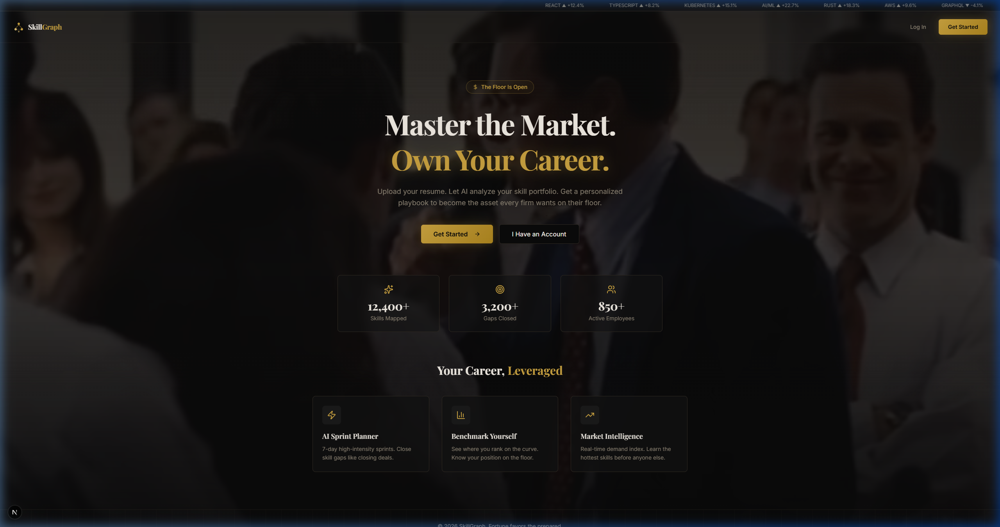
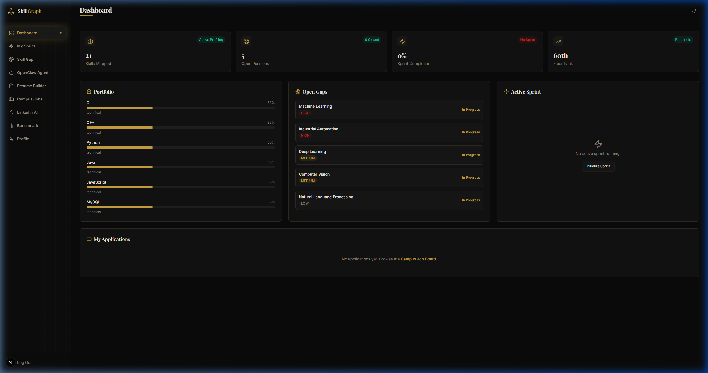
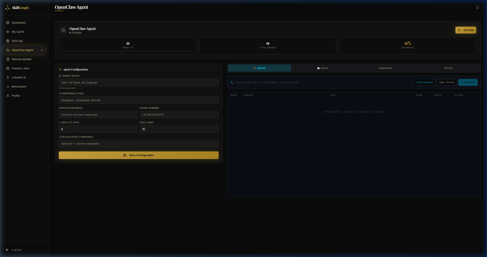
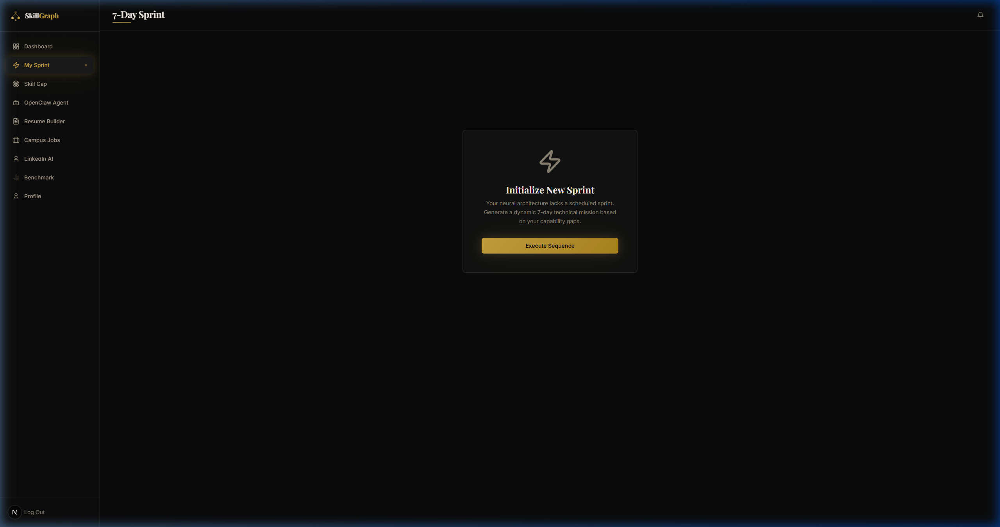

# SkillGraph: AI Career Orchestration Platform

<p align="center">
  
</p>

## Project Status ⚡


SkillGraph is an end-to-end AI career mentor and assisted job-application platform. It finds skill gaps against live market demand, builds focused learning sprints, and prepares tailored, truthful applications — while the student stays in control of every submission.

---

## 🚀 Features

### 1. OpenClaw — Assisted Apply
OpenClaw does the research and preparation; **the student always submits**.
- **Compliant job sources**: official public ATS APIs (Greenhouse, Lever, Ashby), licensed aggregators (JSearch, optional Adzuna) and company career pages. For LinkedIn, Naukri, Indeed and Glassdoor, students paste the job description — SkillGraph never logs into, scrapes or automates those sites, and never stores third-party credentials.
- **10-dimension fit evaluation** with strengths, gaps and negotiation leverage for any job link or pasted description.
- **Nightly preparation**: for active students the worker discovers roles, scores fit, and queues strong matches as *Ready to apply* with a tailored résumé.
- **Interview prep**: STAR story bank and salary-negotiation scripts per role.

### 2. Resume-First Engine
- **Authenticity by design**: the student's real uploaded résumé is the source of truth; AI tailors *only* the 2–3 sentence summary for each posting — no fabricated experience or contact details.
- **ATS-friendly PDF export**, stored privately and downloaded through short-lived signed links.

### 3. Faculty & Recruiter Operating Systems
- **Placement Cell OS**: Equips university faculty with cohort-level skill heatmaps, institutional matching benchmarks, and restricted campus job boards.
- **Recruiter Talent Discovery**: anonymous, skill-based discovery of opted-in students. A student's name and contact details are shared only after they accept that recruiter's request.

### 4. Privacy & Account Security
- Email verification, password reset, and sign-out everywhere on password change.
- Self-service data export and account deletion; consent recorded at sign-up ([Privacy](skillgraph-web/app/privacy/page.tsx), [Terms](skillgraph-web/app/terms/page.tsx)).
- Rate limiting, SSRF-guarded job fetching, private file storage, structured logs with request IDs.

### 5. Topic-Aware Dynamic Sprints
- **Mission Overrides**: Pivot focus to specific topics (e.g., "System Design") on the fly.
- **Learning Resilience**: Integrated YouTube fallbacks ensure resources are always available.

### 6. Production Environment Guardrails
- **Environment Gateway**: Startup fast-fail validation prevents obscure deployment crashes.
- **Dynamic Database Ties**: Elements like `collegeTier` extract real schema relations rather than static fallbacks.

---

## 🛠️ Technology Stack & Architecture

- **Frontend**: Next.js 16 (App Router), Tailwind CSS
- **Database**: PostgreSQL with Prisma ORM
- **Background jobs**: Bull + Redis worker service (`workers/`, `Dockerfile.worker`)
- **Job sources**: Greenhouse / Lever / Ashby public APIs, JSearch, Adzuna
- **AI Orchestration**: GPT-4o / Llama 3.3

---

## 🧭 Road to Production Launch

SkillGraph is moving from a working prototype to a sellable product. The full analysis, options considered and
decision are in **[ADR-001: Production Architecture & Launch-Readiness Plan](docs/adr/ADR-001-production-architecture.md)**.

**Architecture decision:** keep a *modular monolith* for the web tier (Next.js on Vercel), move browser automation
and long-running jobs into a *separate worker service*, and make OpenClaw *compliant-by-design* (official job APIs +
"assisted apply") instead of stealth automation of third-party sites.

| Phase | Focus | Status |
|-------|-------|--------|
| **0 — Launch blockers** | Stop serving user résumés from `public/`, fail-closed cron auth, security headers, rate limiting, consistent validation, health check, `.env.example`, CI | ✅ Done (history purge pending) |
| **1 — Data & storage** | Prisma migrations, indexes & constraints, private object storage with signed URLs, schema-validated AI layer with quotas | ✅ Code done — [migration rollout](docs/adr/ADR-001-production-architecture.md#phase-1--data--storage-week-12) pending |
| **2 — OpenClaw compliance** | Remove stealth plugin & stored third-party cookies, official job sources, assisted apply, containerised workers | ✅ Code done — migration pending |
| **3 — Trust & operations** | Email verification, password reset, mutual-consent recruiter reveal, DPDP/GDPR data rights, observability, tests | ✅ Code done — in review (migrate before merge) |
| **4 — Commercial** | Billing & plan limits, multi-tenant college workspaces, load testing | ⏳ Planned |

```
 Browser ──► Next.js (Vercel, stateless) ──► lib/services ──► Postgres (migrations, backups)
                 │   auth · RBAC · rate limit        ├─► lib/ai (validated outputs, quotas)
                 │                                   └─► private object storage (signed URLs)
                 └─► Redis queue ──► Worker service (job ingestion, sprints, reports, assisted apply)
```

---

## 📂 Platform Gallery

### 🖥️ Main Interfaces
<p align="center">
  
  
</p>

### 🎯 Skill Development
<p align="center">
  
</p>

---

## 🔨 How to Run locally

### 1. Configure the Environment
Clone the repository, copy `skillgraph-web/.env.example` to `skillgraph-web/.env.local` and fill in the values
(database, NextAuth secret, LLM key, Cloudinary). The app fails fast at startup if a required variable is missing.

### 2. Physical Database Sync
Initialize PostgreSQL and apply the versioned migrations:
```bash
cd skillgraph-web
npm run db:migrate:deploy
```
Schema changes are made with `npm run db:migrate:dev -- --name <change>` — do not use `prisma db push` against shared databases.

### 3. Initiate the Dev Server
```bash
npm run dev
```
Navigate to `http://localhost:3000`.

### 4. Background Workers
Requires `REDIS_URL`. Runs market-data refresh, sprint generation, monthly reports and the nightly OpenClaw preparation; exposes `GET /health` on `PORT` (default 8080).
```bash
npm run worker
```
In production, deploy it as its own container: `docker build -f Dockerfile.worker -t skillgraph-worker .`

### 5. Tests
```bash
npm test
```
Unit tests run on Node's built-in test runner; CI also runs the typecheck and lint on every push and pull request.

### 6. Health Check
`GET /api/health` returns `200` when the app and database are reachable (`503` otherwise) — point your uptime monitor here.

---
<p align="center">
  Created with ♥ by ftaakash — SkillGraph v2.5 Stable
</p>
